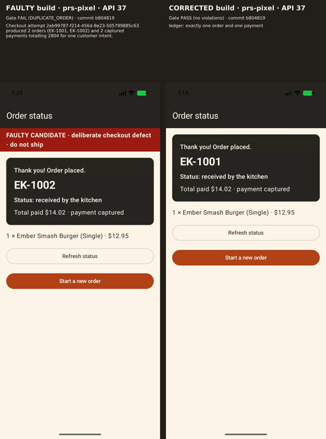

# OrderProof

**A release gate for an Android checkout that catches a double charge the UI never shows.**

Ember Kitchen is a small native Android ordering app (Kotlin, Jetpack Compose) for a fictional
restaurant, backed by a local server with persistent orders and simulated payments. OrderProof
builds two candidates of the app from one source tree:

- **corrected**: retries a lost checkout with the idempotency key it persisted before sending;
- **faulty**: one deliberately changed file mints a fresh key per send.

Both look identical on screen. The release gate drives both through the same eight scenarios on
emulators, injects faults on the server, and then reads the **persisted ledger** with an
independent oracle. When the response to a committed order is lost and the customer taps *Try
again*, the faulty build shows a normal confirmation, and the ledger holds two orders and two
payments. The gate fails it for exactly `DUPLICATE_ORDER` and links to the recording, screenshots,
app log, backend events and ledger. The corrected build passes the same unchanged tests.



## What is in the box

| | |
|---|---|
| App | Menu → customize → cart → server-priced review → simulated payment → order status → recovery after the app is killed. Accessible at 200% text, with clear loading and error states, and a configurable backend address |
| Backend | JDK HTTP server and SQLite: integer-cent pricing, atomic order+payment+stock transaction, idempotent replay, deterministic seed and clock, armed faults (drop or hold the response after commit, 503 outage), loopback-only token-protected control API |
| Scenarios | Normal checkout · lost response after commit ★ · process death mid-submit with reconciliation · repeated taps · item sells out · coupon expires while backgrounded · backend outage · large text on a small screen |
| Oracle | Own SQL, hand-written expectations, never calls production pricing |
| Verifier | Runs × scenarios with reruns as diagnostics; classifies PRODUCT / INFRASTRUCTURE / INCONCLUSIVE; requires complete evidence; checks build identity; writes `report.json` and `report.html` |
| Tests | Backend integration, oracle, verifier and app unit tests (JVM); Compose UI tests; UI Automator lifecycle scenarios on two emulator configurations |

## Quick start

```bash
source scripts/env.sh            # pinned JDK and Android SDK paths; see docs/setup.md
scripts/ci.sh                    # all emulator-free checks
scripts/verify.sh --candidate corrected --runs 3
scripts/verify.sh --candidate faulty --expect-failure DUPLICATE_ORDER
xdg-open runs/<latest>/report.html
```

## Results

See [docs/results.md](docs/results.md) for the executed gate runs (verdicts, clean-run counts,
devices, commit and APK checksums).

## Documentation

| Document | For |
|---|---|
| [docs/behavior-contract.md](docs/behavior-contract.md) | The specification: clauses, pricing, seed data, expected ledgers |
| [docs/architecture.md](docs/architecture.md) | Modules, data flow, design decisions |
| [docs/release-gate.md](docs/release-gate.md) | Running the gate, classification rules, evidence, exit codes |
| [docs/failure-and-recovery.md](docs/failure-and-recovery.md) | What happens in each failure, with log excerpts; harness incidents and their fixes |
| [docs/adding-a-scenario.md](docs/adding-a-scenario.md) | A worked example, from contract to gate |
| [docs/setup.md](docs/setup.md) | Pinned toolchain, emulator setup, everyday commands |
| [docs/ci.md](docs/ci.md) | What CI runs and which stages are local-only |
| [docs/phone-handoff.md](docs/phone-handoff.md) | Checklist for the first physical-phone test |

## Repository layout

```
api-contract/      public API DTOs            control-contract/  test control DTOs
backend/           Ember Kitchen server       app/               Android app (corrected | faulty)
e2e/               UI Automator scenarios     oracle/            ledger judge
verifier/          release gate CLI           scripts/           ci, verify, dist, demo-video, emulator, backend
docs/              everything above
```

## Scope

Out of scope by design: authentication, real payments, maps, iOS, chat or agent features. All
orders and payments are fictional. The control API never ships in the app and never listens beyond
loopback.
